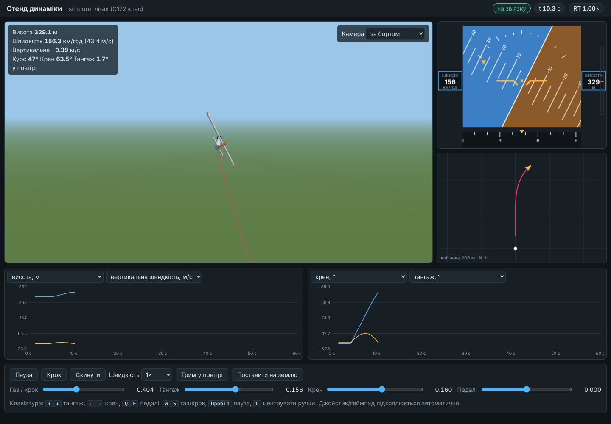

# Стенд динаміки

`simulator-bench` — це стенд реального часу з візуалізацією в браузері.
Він крутить модель динаміки (вбудовану simcore або вашу DLL з таргета
`kos_simulation`) синхронно з реальним часом. Керувати можна з клавіатури,
геймпада/джойстика або повзунками.



## Що показує

- **3D-вигляд** (three.js): апарат (вертоліт або літак), слід польоту, тінь,
  злітна смуга/майданчик у точці старту. Камера: за бортом, огляд мишею
  (колесо — відстань), із землі.
- **Авіагоризонт**: крен і тангаж зі шкалою, швидкість, висота, вертикальна
  швидкість, стрічка курсу.
- **Карта** зверху, північ угорі, з траєкторією й автомасштабом.
- **Два графіки** за останні 60 с, по два канали на кожному. Канали обираються
  зі списку: стандартні (висота, швидкості, кути) і **всі скалярні виходи
  моделі** (для GorEl це 55 каналів, для AK1-3 — 103).
- **Панель**: пауза, крок, скидання, швидкість часу 0.25–5×, кнопки дій моделі
  (трим, катапульта, парашут…), чотири осі керування.

## Запуск

Вбудовані моделі (працює на будь-якій ОС):

```bash
dotnet run --project managed/src/Simulator.Bench -c Release                     # вертоліт, висіння 100 м
dotnet run --project managed/src/Simulator.Bench -c Release -- --model fixed-wing --altitude 300
```

Відкрийте http://localhost:5080. Щоб відкрити з іншого комп'ютера в мережі,
додайте `--host 0.0.0.0`.

### Ваші DLL (AK13Dynamics, DynamicsGorEl)

DLL зібрані під x86, тому стенд має бути 32-бітним. На Windows:

```powershell
./bench_x86.ps1     # ядро під Win32 + self-contained win-x86 -> out\bench-x86

out\bench-x86\simulator-bench.exe --profile profiles\gorel.json --dll C:\DynamicsNEW\GOR-El\DynamicsGorEl.dll
out\bench-x86\simulator-bench.exe --profile profiles\ak13.json  --dll C:\DynamicsNEW\AK1_3\slx\out\SimCore\AK13Dynamics.dll
```

Якщо `--dll` не вказано, береться поле `"dll"` з профілю, відносно теки
профілю.

## Керування

| | Клавіатура | Геймпад |
|---|---|---|
| Тангаж (+ ніс угору) | ↑ / ↓ | лівий стік, вісь Y (на себе = угору) |
| Крен (+ праворуч) | → / ← | лівий стік, вісь X |
| Педалі (+ ніс праворуч) | E / Q | правий стік, вісь X |
| Газ / загальний крок | W / S | правий стік, вісь Y |
| Пауза | Пробіл | |
| Центрувати ручки | C | |

Клавіші плавно зсувають осі, поки їх тримати, і значення лишається там, де
його відпустили (як тример). Геймпад перехоплює керування, щойно зрушити стік.

## Профіль моделі (profiles/*.json)

Профіль описує, які порти DLL що означають. Код стенда при цьому не
змінюється. Коментарі `//` у JSON дозволені.

```jsonc
{
  "name": "GOR-Electric", "kind": "fixed-wing",       // kind: fixed-wing | helicopter (3D-форма)
  "dll": "DynamicsGorEl.dll",
  "inputs": { "aircraft_mass_kg": 11, ... },          // сталі входи, задаються при кожному скиданні
  "reset": { "port": "Reposition", "holdSteps": 2 },  // імпульс скидання після старту
  "roll":  { "port": "roll_deg" },                    // кути в градусах: value = offset + scale * port
  "pitch": { "port": "pitch_deg" },
  "yaw":   { "port": "course_deg" },
  "position": { "mode": "absolute", "north": "Xg_m", "east": "Zg_m", "up": "Yg_m" },
            // або "mode": "increments" — порти дають прирости за крок, стенд їх сумує
  "airspeed": { "port": "trueAirspeed_kph", "scale": 0.27778 },   // м/с
  "verticalSpeed": { "port": "Vyg_mps" },
  "onGround": { "port": "inAir", "invert": true },
  "controls": {
    "throttle": { "port": "P1", "min": 0, "max": 40, "initial": 0 },   // u ∈ [0,1] -> min..max
    "pitch": { "port": "ctrl_pitch", "scale": -1 },                    // value = trim + offset + scale*u
    "roll":  { "port": "ctrl_roll",  "scale": -1 },
    "yaw":   { "port": "ctrl_hdg" }
    // "trimFrom": "RLX_BAL" — центр осі береться з виходу моделі після скидання
  },
  "actions": [
    { "id": "fire", "label": "Пуск", "set": { "catapult_fire": 1 } },          // фіксується
    { "id": "kick", "label": "Імпульс", "set": { "X": 1 }, "holdSteps": 5 }    // 5 кроків, потім 0
  ]
}
```

Під час старту стенд перевіряє, що всі порти з профілю існують у DLL і є
скалярними `double`. Якщо ні, він зупиняється зі списком невідповідних імен.

### Готові профілі

- **`gorel.json`**: GOR-Electric. Знаки керування взято з `CHANGELOG_ua.md`
  (`ctrl_pitch > 0` — ніс униз, `ctrl_roll > 0` — крен уліво). Тяга `P1`
  0–40 Н (14 Н тримає горизонт на ~104 км/год). Катапульта 3.5 м / 12° /
  18 м/с за README. Дії: «На катапульту», «Пуск», «Зняти з катапульти»,
  «Парашут».
- **`ak13.json`**: AK1-3. **Одиниці й знаки `RLX`/`RLY`/`RLZ`/`RLN` треба
  звірити** з `model\lib\ak13_in_pilot.m`, бо цього файлу не було в архіві.
  Так само треба звірити систему координат `stepForward/Rightward/Upward_M`.
  Осі стартують з балансувальних положень `*_BAL`.

## Як влаштовано

```
браузер (wwwroot: three.js, canvas)  ⇄  WebSocket /ws (~30 Гц JSON)  ⇄  BenchRunner (потік моделі)
                                                                            │
                                     SimcoreBenchModel (libsimcore)  або  KosBenchModel (KosModel + профіль)
```

- `BenchRunner` крокує модель її власним кроком і прив'язаний до годинника.
  Якщо модель не встигає, модельний час сповільнюється, а не накопичує борг
  (індикатор **RT** у шапці показує фактичну швидкість).
- Скидання створює новий екземпляр DLL, бо це єдиний надійний спосіб
  повернути згенеровану модель у t = 0.
- REST: `GET /api/info` повертає модель і дії, `GET /api/state` — останній
  кадр.
- WebSocket-команди: `{"type":"controls",throttle,pitch,roll,yaw}`, `pause`,
  `resume`, `reset`, `speed` (`value`), `step` (`value`), `action` (`id`).
